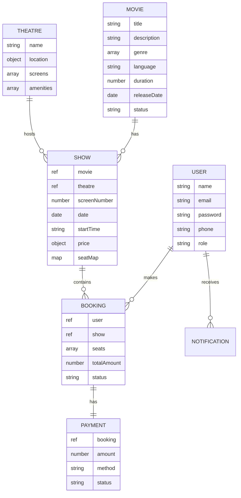

# 🎬 IMovies - Cinema Booking Management System

A full-stack cinema booking platform built with the **MERN Stack** (MongoDB, Express.js, React.js, Node.js) that enables users to browse movies, explore showtimes, select seats, and book tickets seamlessly.


## ✨ Features

### 🎭 User Features
- **Movie Browsing** - Explore now showing, coming soon, and top-rated movies
- **Smart Search & Filters** - Filter movies by genre, language, certificate, and rating
- **Real-Time Seat Selection** - Interactive seat map with live availability via Socket.IO
- **Ticket Booking** - Seamless booking flow with seat selection and payment
- **Booking Management** - View upcoming/past bookings and cancel if needed
- **Secure Authentication** - JWT-based login/registration with password encryption

### 🔧 Admin Features
- **Dashboard** - Overview stats (revenue, bookings, users, movies)
- **Movie Management** - Full CRUD for movies with poster uploads
- **Theatre Management** - Manage theatres, screens, and seat layouts
- **Show Scheduling** - Create and manage show timings
- **Booking Oversight** - View and manage all bookings

### 🔒 Security
- JWT token authentication
- Password hashing with bcrypt
- Role-based access control (User/Admin)
- API rate limiting
- Input validation and sanitization
- Helmet security headers

## 🏗️ Tech Stack

| Layer | Technologies |
|-------|-------------|
| **Frontend** | React 18, Redux Toolkit, Material UI 5, React Router 6, Socket.IO Client |
| **Backend** | Node.js, Express.js, Socket.IO, JWT, Multer |
| **Database** | MongoDB with Mongoose ODM |
| **Auth** | JWT + bcrypt.js |
| **Styling** | Material UI + Custom CSS (Dark Cinema Theme) |

## 📁 Project Structure

```
imovies/
├── backend/
│   ├── config/
│   │   └── db.js                 # MongoDB connection
│   ├── controllers/
│   │   ├── authController.js     # Auth operations
│   │   ├── movieController.js    # Movie CRUD
│   │   ├── theatreController.js  # Theatre CRUD
│   │   ├── showController.js     # Show management
│   │   ├── bookingController.js  # Booking operations
│   │   ├── paymentController.js  # Payment processing
│   │   └── notificationController.js
│   ├── middleware/
│   │   ├── auth.js               # JWT authentication
│   │   ├── errorHandler.js       # Global error handler
│   │   ├── rateLimiter.js        # API rate limiting
│   │   └── validator.js          # Input validation
│   ├── models/
│   │   ├── User.js
│   │   ├── Movie.js
│   │   ├── Theatre.js
│   │   ├── Show.js
│   │   ├── Booking.js
│   │   ├── Payment.js
│   │   └── Notification.js
│   ├── routes/
│   │   ├── authRoutes.js
│   │   ├── movieRoutes.js
│   │   ├── theatreRoutes.js
│   │   ├── showRoutes.js
│   │   ├── bookingRoutes.js
│   │   ├── paymentRoutes.js
│   │   └── notificationRoutes.js
│   ├── utils/
│   │   ├── logger.js             # Winston logger
│   │   ├── helpers.js            # Utility functions
│   │   └── seeder.js             # Database seeder
│   ├── uploads/                  # Uploaded files
│   ├── server.js                 # Entry point
│   ├── package.json
│   └── .env
├── frontend/
│   ├── public/
│   │   └── index.html
│   ├── src/
│   │   ├── components/
│   │   │   ├── common/           # Navbar, Footer, Loading, SearchBar, HeroSlider
│   │   │   ├── movies/           # MovieCard, MovieGrid, MovieFilter, MovieDetail
│   │   │   ├── booking/          # SeatMap, ShowList, BookingSummary, PaymentForm
│   │   │   ├── auth/             # LoginForm, RegisterForm
│   │   │   └── admin/            # AdminSidebar, AdminLayout, DataTable, Forms
│   │   ├── pages/                # All page components
│   │   ├── redux/
│   │   │   ├── store.js
│   │   │   └── slices/           # authSlice, movieSlice, bookingSlice, showSlice, uiSlice
│   │   ├── services/             # API service modules
│   │   ├── utils/                # ProtectedRoute, constants, helpers
│   │   ├── App.js
│   │   ├── App.css
│   │   └── index.js
│   └── package.json
└── README.md
```

## 🚀 Getting Started

### Prerequisites
- **Node.js** v16 or higher
- **MongoDB** (local or Atlas cloud)
- **npm** or **yarn**

### Installation

1. **Clone the repository**
   ```bash
   cd imovies
   ```

2. **Install backend dependencies**
   ```bash
   cd backend
   npm install
   ```

3. **Install frontend dependencies**
   ```bash
   cd ../frontend
   npm install
   ```

4. **Configure environment variables**
   
   Edit `backend/.env`:
   ```env
   PORT=5000
   MONGODB_URI=mongodb://localhost:27017/imovies
   JWT_SECRET=your_secret_key_here
   JWT_EXPIRE=7d
   NODE_ENV=development
   ```

5. **Seed the database** (optional)
   ```bash
   cd backend
   node utils/seeder.js
   ```

6. **Start the application**
   
   Backend (from `backend/` directory):
   ```bash
   npm run dev
   ```
   
   Frontend (from `frontend/` directory):
   ```bash
   npm start
   ```

7. **Access the application**
   - Frontend: http://localhost:3000
   - Backend API: http://localhost:5000/api/v1

### Default Admin Credentials (after seeding)
- **Email:** admin@imovies.com
- **Password:** admin123

## 📡 API Endpoints

### Authentication
| Method | Endpoint | Description | Auth |
|--------|----------|-------------|------|
| POST | `/api/v1/auth/register` | Register new user | No |
| POST | `/api/v1/auth/login` | Login user | No |
| GET | `/api/v1/auth/me` | Get current user | Yes |
| PUT | `/api/v1/auth/profile` | Update profile | Yes |
| PUT | `/api/v1/auth/change-password` | Change password | Yes |

### Movies
| Method | Endpoint | Description | Auth |
|--------|----------|-------------|------|
| GET | `/api/v1/movies` | Get all movies (with filters) | No |
| GET | `/api/v1/movies/:id` | Get movie by ID | No |
| GET | `/api/v1/movies/now-showing` | Get now showing movies | No |
| GET | `/api/v1/movies/coming-soon` | Get coming soon movies | No |
| POST | `/api/v1/movies` | Create movie | Admin |
| PUT | `/api/v1/movies/:id` | Update movie | Admin |
| DELETE | `/api/v1/movies/:id` | Delete movie | Admin |

### Theatres
| Method | Endpoint | Description | Auth |
|--------|----------|-------------|------|
| GET | `/api/v1/theatres` | Get all theatres | No |
| GET | `/api/v1/theatres/:id` | Get theatre by ID | No |
| POST | `/api/v1/theatres` | Create theatre | Admin |
| PUT | `/api/v1/theatres/:id` | Update theatre | Admin |
| DELETE | `/api/v1/theatres/:id` | Delete theatre | Admin |

### Shows
| Method | Endpoint | Description | Auth |
|--------|----------|-------------|------|
| GET | `/api/v1/shows` | Get all shows | No |
| GET | `/api/v1/shows/:id` | Get show by ID | No |
| GET | `/api/v1/shows/movie/:movieId` | Get shows by movie | No |
| GET | `/api/v1/shows/:id/seats` | Get available seats | No |
| POST | `/api/v1/shows` | Create show | Admin |
| PUT | `/api/v1/shows/:id` | Update show | Admin |
| DELETE | `/api/v1/shows/:id` | Delete show | Admin |

### Bookings
| Method | Endpoint | Description | Auth |
|--------|----------|-------------|------|
| POST | `/api/v1/bookings` | Create booking | Yes |
| GET | `/api/v1/bookings/my` | Get user's bookings | Yes |
| GET | `/api/v1/bookings/:id` | Get booking by ID | Yes |
| PUT | `/api/v1/bookings/:id/cancel` | Cancel booking | Yes |
| GET | `/api/v1/bookings` | Get all bookings | Admin |

### Payments
| Method | Endpoint | Description | Auth |
|--------|----------|-------------|------|
| POST | `/api/v1/payments/process` | Process payment | Yes |
| GET | `/api/v1/payments/:id` | Get payment by ID | Yes |

## 🔌 Real-Time Features (Socket.IO)

The application uses Socket.IO for real-time seat availability updates:

| Event | Direction | Description |
|-------|-----------|-------------|
| `joinShow` | Client → Server | Join a show's seat selection room |
| `seatSelected` | Bidirectional | Seat selected by a user |
| `seatReleased` | Bidirectional | Seat deselected by a user |
| `bookingConfirmed` | Server → Client | Seats confirmed as booked |

## 🎨 Theme

The application uses a custom **dark cinema theme**:
- **Background:** `#1a1a2e`
- **Card Background:** `#16213e`
- **Primary (Accent):** `#e94560`
- **Secondary:** `#0f3460`
- **Text:** `#ffffff`

## 📊 Database Schema



## 🧪 Testing

Use **Postman** to test the backend API endpoints. Import the API endpoints from the table above.

Key test scenarios:
- ✅ User registration and login flows
- ✅ Movie CRUD operations (admin)
- ✅ Movie search and filtering
- ✅ Show creation and seat availability
- ✅ Seat selection and booking creation
- ✅ Payment processing (simulated)
- ✅ Booking cancellation and refund
- ✅ Role-based access control

## 📄 License

This project is licensed under the MIT License.

## 🤝 Contributing

1. Fork the repository
2. Create your feature branch (`git checkout -b feature/AmazingFeature`)
3. Commit your changes (`git commit -m 'Add some AmazingFeature'`)
4. Push to the branch (`git push origin feature/AmazingFeature`)
5. Open a Pull Request

---

**Built with ❤️ using the MERN Stack**
